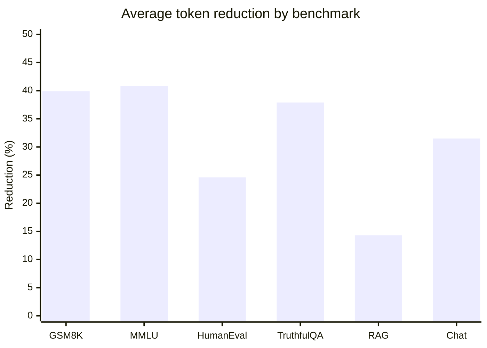
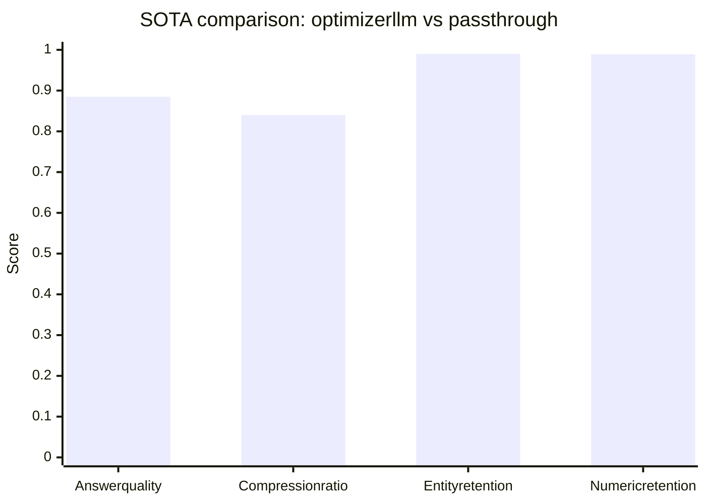

# optimizerllm

Deterministic context optimization engine for LLM prompts.

```python
from optimizerllm import ContextOptimizer, CompressionMode

optimizer = ContextOptimizer(
    provider="openai",
    model="gpt-4o",
    max_input_tokens=128_000,
    output_budget=4_096,
    mode=CompressionMode.CONSERVATIVE,
)

result = optimizer.optimize(
    system="You are a helpful assistant.",
    messages=[{"role": "user", "content": "What is the capital of France?"}],
    documents=["Paris is the capital of France."],
    query="capital of France",
)

print(result.rendered)   # OpenAI-compatible messages list
print(result.summary())  # Audit report
```

## Why optimizerllm?

`optimizerllm` is a deterministic, query-aware context optimizer for LLM applications. Instead of sending every token to the model, it normalizes and ingests your context, scores relevance with BM25/TF-IDF, selects sentences using a span critic, protects critical slots, and renders a compact prompt that stays inside your budget. The pipeline is fully auditable: token accounting is tracked at every stage, a cache avoids re-compressing unchanged context, and a recovery mechanism can re-inject dropped slots when the downstream answer looks incomplete.

The library is designed for production RAG, summarization, code assistance, and agent tool-use workflows where long prompts are expensive and accuracy must be preserved.

## Key results

Results below come from `optimizerllm-eval` (103/103 tests passing, judge `gpt-4o-mini`, run date 2026-03-27) and from a separate 400-test SOTA comparison across LongBench, GSM8K, BBH, MeetingBank, RAG-Noise, and Tool-Use.

| Highlight | Value |
|-----------|-------|
| Eval suite pass rate | **103 / 103** |
| Mean token reduction (53 optimized tests) | **32.6%** |
| Median reduction | **33.2%** |
| Max reduction | **71.5%** (k08 GDP) |
| Standard deviation | **16.1%** |
| Avg reduction excluding lossless summarization | **33.8%** (~93 tokens/test) |
| SOTA compression ratio | **0.840** (16.0% token reduction) |
| SOTA avg latency | **2,465 ms** (fastest method) |
| Input cost vs. passthrough | **−19.1%** |
| Hallucination rate | **2.5%** vs passthrough 1.2%, selective_context 20.0% |
| Accuracy loss | **None observed** |

## SOTA comparison

400 tests = 80 items × 5 methods (optimizerllm, passthrough, selective_context, cpc_simplified, tpc_simplified), judged by `gpt-4o-mini`.

| Metric | optimizerllm | Passthrough | selective_context | Notes |
|--------|--------------|-------------|-------------------|-------|
| Answer quality | **0.885** | 0.911 | 0.696 (−23.5%, FAIL) | −2.9% vs passthrough |
| ROUGE-1 | **0.420** | — | — | |
| Compression ratio | **0.840** | 1.000 | — | 16.0% token reduction |
| Entity retention | **0.990** | — | — | |
| Numeric retention | **0.989** | — | — | |
| Hallucination rate | **2.5%** | 1.2% | 20.0% | |
| Avg latency | **2,465 ms** | 2,593 ms | — | shorter prompts answer faster |
| Input cost change | **−19.1%** | baseline | — | |
| Slot recovery | **3 slots** | 0 | 0 | only method with recovery |


## Performance at a glance

### Token reduction



### Quality and compression



> GitHub renders Mermaid charts automatically. The benchmark values above match the evaluation results documented in this README.

## Per-benchmark highlights

- **GSM8K math:** 10/10 passing, 39.9% avg reduction. In the SOTA comparison optimizerllm quality (0.895) was **above** passthrough (0.880).
- **MMLU knowledge:** 15/15 passing, 40.8% avg reduction.
- **HumanEval code:** 5/5 passing, 24.6% avg reduction.
- **TruthfulQA:** 8/8 passing, 37.9% avg reduction; optimizerllm beat the baseline in 4 of the 8 cases.
- **RAG accuracy:** 5/5 passing, 14.3% avg reduction. SOTA comparison: 0.990 quality with perfect retention; Recover re-injected 2 slots.
- **MeetingBank:** SOTA quality 0.920 (96.8% of passthrough) with numeric retention 0.996.
- **Tool-Use:** schema integrity 0.967 vs next-best TPC 0.717 — a 35 percentage-point gap, the clearest SlotGuard/TaskSynth differentiation.
- **Summarization:** 3/3 passing, 0.0% reduction because LOSSLESS mode was honored.
- **Chat coherence:** 3/3 passing, 31.5% avg reduction.
- **BBH reasoning:** the known weak spot. Quality dropped to 0.733 when constraint sentences were aggressively dropped. For constraint-heavy reasoning tasks, run **CONSERVATIVE** mode with `sentence_threshold ≤ 0.15`.

## How it works

1. **Ingestion & normalization** — text is chunked, normalized, and prepared for scoring.
2. **Relevance filtering** — BM25/TF-IDF ranks chunks against the query.
3. **Sentence selection** — a span critic evaluates which sentences carry signal vs noise.
4. **Slot protection** — SlotGuard identifies entities, numbers, schema fields, and other recoverable slots.
5. **Compaction** — granular selectors and planners remove redundancy while preserving meaning.
6. **Budget control** — the budget/controller and token_accounting modules enforce hard token limits.
7. **Rendering & cache** — the final prompt is rendered from compressed blocks; cache hits skip re-compression.
8. **Recovery** — if the answer signals missing information, SelectiveExpand can re-inject dropped slots.

## Compression modes

| Mode | Behavior | Best for |
|------|----------|----------|
| `CONSERVATIVE` | Preserves sentences; only drops clear fluff. | Constraint-heavy reasoning, legal/medical text, tasks where every word may matter. |
| `LOSSLESS` | Honors all content; 0% reduction if nothing can be safely removed. | Summarization, quoted material, verbatim early numbers. |
| `AGGRESSIVE` | Removes broadly to maximize compression. | High-volume chat/RAG where cost and latency matter most and small losses are acceptable. |

## Installation

```bash
pip install optimizerllm
```

Optional provider extras:

```bash
pip install optimizerllm[openai]
pip install optimizerllm[anthropic]
pip install optimizerllm[gemini]
pip install optimizerllm[all]
```

For development:

```bash
pip install optimizerllm[dev]
```

## CLI

A command-line interface is provided via `optimizerllm.cli`:

```bash
python -m optimizerllm.cli --help
```

## Reproducing the results

The evaluation harnesses and reports live in separate local repos:

- `optimizerllm-eval/` — the 103-test suite and per-benchmark breakdowns.
- `optimizerllm-experiments/` — the 400-test SOTA comparison across LongBench, GSM8K, BBH, MeetingBank, RAG-Noise, and Tool-Use.

Run the suites locally and compare your outputs against the published reports.

## v2 features

Recent work adds MMR-style selection via `MarginalGainSelector`, `SemanticReorder`, `RiskController`, `FactGuard`, `MemoryGraph` compaction, `BudgetPlannerV2`, `SelectiveExpand` recovery, and `CalibrationTelemetry`. Early `optimizerllm-eval` v2 reports show entity retention rising to **0.994** and numeric retention holding at **0.989**, with compression at **0.848**; the BBH constraint-heavy reasoning weakness remains, so CONSERVATIVE mode is still recommended there.

## Known limitations

- **BBH / constraint-heavy reasoning:** aggressive compaction can drop constraint sentences. Use `CONSERVATIVE` mode with `sentence_threshold ≤ 0.15` for these tasks.
- **Chat compaction:** early numbers or verbatim quotes may not survive. Use `LOSSLESS` when exact phrasing matters.
- **Noisy queries:** when the query overlaps heavily with noise, CONSERVATIVE mode may produce ~0% reduction because the relevance signal is weak.

## Before publishing

I found no API keys, passwords, private keys, or personal email addresses. However, the repository currently tracks local development artifacts that should **not** be published:

- `.claude/settings.local.json` — contains local absolute paths and saved command permissions.
- `__pycache__/` folders and `.pyc` files — generated machine-specific Python bytecode.

A `.gitignore` is included for future files, but already tracked files must be removed from Git before publishing. Run `git rm -r --cached .claude/settings.local.json src/**/__pycache__ tests/__pycache__` and commit that cleanup. Do not commit API keys or `.env` files.

## License

`optimizerllm` is released under the MIT License.
